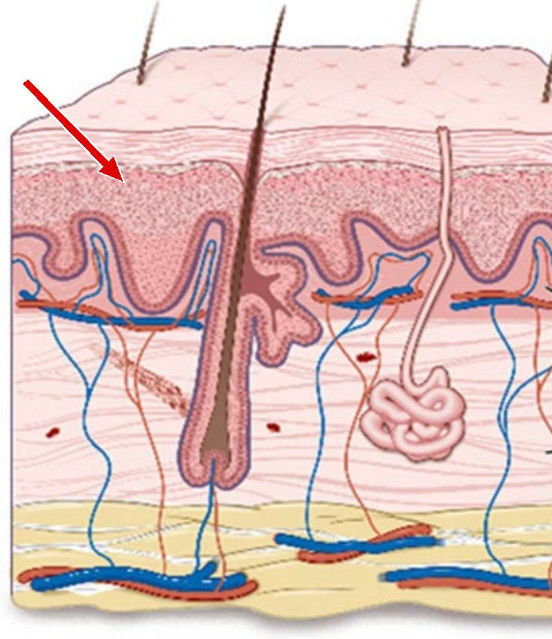
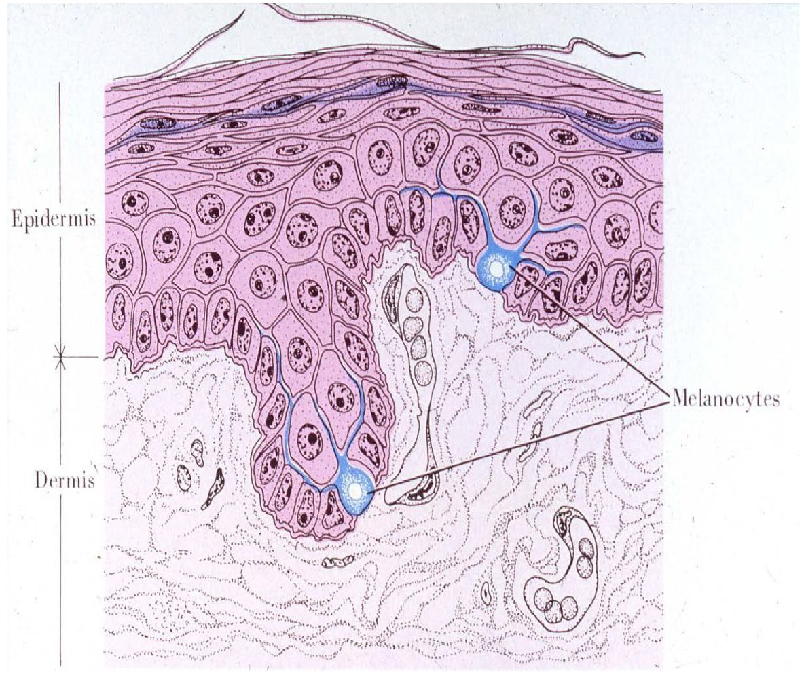

# WPS-Archive site: how it works and how to add to it

This is the reference for anyone (or any Claude chat in this project) adding questions, library pages, or images to the WPS-Archive practice question site. The current copies of every site file sit next to this document in the project's WPS-Archive-Site folder. They were last updated on October 28, 2026.

## Files in the GitHub repo

Everything lives in one GitHub Pages repo. index.html is the whole site, and it reads plain-text files that sit in the same folder as index.html.

| File or folder | What it does |
|---|---|
| index.html | The site. It loads the question and library files below every time it opens. |
| FOM_Practice_Question_Bank_1.txt | Foundations of Medicine questions 1 to 1236. The site looks for this exact file name. |
| questions.txt | A short table of contents. Its `Include:` lines load the other question files (currently `MSK_Questions.txt`, `MSK_Week_14_Questions.txt` and `MSK_Week_15_Questions.txt`). |
| MSK_Questions.txt | MSK Week 13 questions, 1237 to 1826. |
| MSK_Week_14_Questions.txt | MSK Week 14 questions, 1827 to 2773. |
| MSK_Week_15_Questions.txt | MSK Week 15 questions, 2774 to 3476. |
| library.txt | Every library page (1,304 pages), all modules in one file. |
| library/images/msk-week-13/ | Library page images for MSK Week 13 (429 files). |
| library/images/msk-week-13/questions/ | Question images for MSK Week 13 (labels removed). |
| library/images/msk-week-14/ | Library page images for MSK Week 14 (277 files). |
| library/images/msk-week-14/questions/ | Question images for MSK Week 14 (305 files). |
| library/images/msk-week-15/ | Library page images for MSK Week 15 (169 files). |
| library/images/msk-week-15/questions/ | Question images for MSK Week 15 (222 files), plus IMAGE-CREDITS.txt for the 60 that come from outside the lectures. |
| library/images/msk-back-images/ | Anatomy Lab: Vertebral Column and Back question images. The bas- files are CC BY-SA and need an IMAGE-CREDITS.txt alongside them, which is currently missing from the repo. |

The site also looks for `Week_8_Practice_Questions.txt`. If it isn't in the repo, the site skips it without an error.

File names must match exactly, capital letters included, with no spaces or quote marks. A misnamed bank file is silently skipped, and the browser keeps showing the questions it saved earlier, which hides the problem.

## How the site loads files

- On open, the site reads `FOM_Practice_Question_Bank_1.txt`, `Week_8_Practice_Questions.txt`, and `questions.txt`, then every file named on an `Include:` line inside them. Library loading starts from `library.txt` the same way.
- Include paths are relative to the folder that holds index.html. One file per Include line, up to 100 files in total.
- To add a new batch without touching index.html, put it in its own file (for example `MSK_Week_16_Questions.txt`) and add an `Include:` line to questions.txt. Keeping files per module or per week also keeps GitHub's web editor working; one combined bank got too large for it.
- Files only load from the web address, not when index.html is opened from a computer.
- GitHub's web upload takes at most 100 files at a time, so image batches go in zips of 90 or fewer.

## Folder names

Every question starts with a heading line `Module / Week / Lecture`, and every library page has a `Folder: Module / Week / Lecture` line. Those names build the folders in Create Test and the Library tab. Use the existing names exactly so new material lands in the same folder.

Library folders currently in use:

- Foundations of Medicine / Week 2: Cellular, Molecular, and Genetic Foundations / (lecture)
- Foundations of Medicine / Week 3: Metabolic Foundations / (lecture)
- Foundations of Medicine / Week 4: Foundations of Genetics / (lecture)
- Foundations of Medicine / Week 5: Foundations of Cancer Biology and Cancer Genetics / (lecture)
- Foundations of Medicine / Week 6: Foundations of Immunology / (lecture)
- Foundations of Medicine / Week 7: Hematology / (lecture)
- Foundations of Medicine / Week 8: Foundations of Microbiology I / (lecture)
- Foundations of Medicine / Week 9: Foundations of Microbiology II / (lecture)
- Foundations of Medicine / Week 10: Foundations of Early Development / (lecture)
- Foundations of Medicine / Biostatistics / (topic)
- MSK / Week 13 / (lecture)
- MSK / Week 14 / (lecture)
- MSK / Week 15 / (lecture)

FOM question headings use shorter names than the library (for example `Foundations of Medicine / Week 2 / Cell Structure & Organelles`). That's fine, because questions link to library pages through Reference lines, never through their heading. MSK question headings match the library folder names exactly.

MSK / Week 13 lectures, in course order (questions and library pages are kept in this order):

1. Introduction to the Musculoskeletal System
2. Overview of the Nervous System and Spinal Cord
3. Membrane Properties of Excitable Cells: Ion Channels and Action Potentials
4. Connective Tissue Histology
5. Peripheral Nervous System and Spinal Cord Histology
6. Peripheral Nervous System: Somatic and Autonomic
7. Vertebral Column and Back
8. Integument
9. Introduction to Dermatology and Vesiculobullous Diseases
10. Spectrum of Acneiform Disorders, Pigmentation, and Hair

The question bank also has `MSK / Week 13 / Anatomy Lab: Vertebral Column and Back` (questions 1690 to 1826). It has no library pages of its own; its questions reference the Vertebral Column and Back pages.

MSK / Week 14 lectures, in course order:

1. Pectoral Region and Axilla (42 pages)
2. Anterior Arm and Cubital Fossa (25 pages)
3. Shoulder and Posterior Arm (46 pages)
4. Papulosquamous Diseases (31 pages)
5. The Spectrum of Eczema (29 pages)
6. Cutaneous Neoplasms (41 pages)
7. Skin and Soft Tissue Infections (34 pages)
8. Hypersensitivity Reactions to Drugs or Infections (27 pages)
9. Musculoskeletal Imaging Basics (35 pages)

MSK / Week 15 lectures, in course order:

1. Bone and Cartilage Histopathology (34 pages, 117 questions)
2. Non-Neoplastic Bone Pathology (24 pages, 96 questions)
3. Bone Growth, Formation, and Fractures (34 pages, 118 questions)
4. Anterior Forearm and Elbow (31 pages, 104 questions)
5. Wrist and Palm of Hand (37 pages, 124 questions)
6. Introduction to Rheumatologic Disease (42 pages, 144 questions)

New MSK weeks follow the same pattern: `MSK / Week 16 / (Lecture name)`, with the lecture name copied from the slides.

## Question format

One block per question, blocks separated by a blank line, fields in this order:

```
MSK / Week 13 / Integument
Question 1456
A stem ending with the lead-in "Which of the following ...?"

A. ...
B. ...
C. ...
D. ...
E. ...
Answer: C. exact text of choice C
Order: First / Second / Third
Difficulty: Easy / Medium / Hard
Reference: Library page title; Another page title
Why this is correct:
Explanation.
Why the other answers are wrong:
A. One line per wrong choice.
B. ...
D. ...
E. ...
Objective: The lecture objective, copied exactly
```

- The image line is optional and goes right after the stem. Alt text stays neutral ("H&E micrograph", "Clinical photo") so it doesn't give the answer away, and image file names don't reveal the answer either.
- Lectures with no learning objectives (Connective Tissue Histology, Introduction to Dermatology and Vesiculobullous Diseases, and the five Week 14 dermatology lectures) leave the Objective line off. All three original Week 14 anatomy lectures, Musculoskeletal Imaging Basics, and all six Week 15 lectures state objectives, so every one of their questions carries one.
- Numbering runs continuously across the whole bank. FOM is 1 to 1236, MSK Week 13 is 1237 to 1826, Week 14 is 1827 to 2773, Week 15 is 2774 to 3476, and the next new question is 3477.
- Spread the correct answer across the letters. A batch written straight through tends to pile the answer on one letter, so check the distribution before importing.
- Question style rules for this project (mock exam stems, labs as high or low, distractors from the same lecture, no em-dashes, and so on) are in the project's question format preference.

## How the site tells questions apart

The site matches questions by their stem text, so re-importing a question updates it instead of duplicating it, and saved progress follows the question even if its number changes. Images are ignored in that comparison. Two questions with the same stem wording and different pictures can get mixed up if they are later renumbered or moved, so give every question its own wording. Before importing a batch, check its stems against the ones already in the bank, because a collision quietly overwrites an existing question instead of adding a new one.

## Library pages

```
Library: Page title
Folder: MSK / Week 13 / Integument

## Identify it

- Bullet
- Bullet



> One callout with the single most testable fact.
```

- Titles must be unique across the whole library (case doesn't matter), because Reference lines match by title.
- Supported formatting: `##` headings, `-` bullets, `1.` numbered lists, `|` tables with a dash row, one `>` callout, `**bold**`, `*italic*`, links, and images. No HTML.
- A `Reference:` value can also be a folder path, which links every page in that folder, but a folder with no pages produces a warning in the Library tab.
- Image names are lowercase with hyphens, prefixed by lecture. Week 13 uses topic prefixes (intro-, nssc-, histo-, pns-, vert-, ct-, derm-, memb-, integ-, vbd-) and question images use q-(prefix)-NN. Weeks 14 and 15 use a lecture prefix plus slide number instead (pect-sNN, bonehisto-sNN), where the number is the slide in that lecture's PDF, so any figure traces back to its slide in one step.
- A derived image (a crop made to remove a burned-in label, for example) is numbered in a 900 series rather than given a letter suffix. The pattern the tooling matches on is a prefix and digits, so a trailing letter makes the file invisible to both the question-image count and the packaging step.

## Where the images come from

Week 14 and Week 15 library images are full lecture slides rendered from the lecture PDFs at 130 to 140 dpi. They carry the slide's own labels, which is what makes them usable for identification study. Question images are the bare pictures cut out of those slides.

Two things learned the hard way and worth repeating:

- The text extraction loses anything the lecturer pasted in as a picture, which is most comparison tables, classification boxes and labeled figures, so build from the rendered slides rather than the text dump.
- When a slide holds several panels, the order the images extract in does not match the order they appear on the slide, so check every multi-panel assignment against the render before keying a question to it.

Week 15 also uses 60 images from outside the lectures, so that identification questions test reading an unfamiliar specimen rather than recalling the lecturer's own figure. Those are from Wikimedia Commons under CC BY, CC BY-SA, CC0 or public domain only, nothing non-commercial, and they are named `ext-...`. Their attribution lives in `library/images/msk-week-15/questions/IMAGE-CREDITS.txt`, which has to stay in that folder. Credits never go inside a question's text.

The Bootcamp.com supplementary decks that came with the Week 14 lectures were deliberately not used as an image source: those figures are commercial illustrations with a watermark, and they are drawings rather than real tissue, which fails the project's rule that anatomy identification questions use real images. For the same reason, the Netter-style illustrations and 3D renders in the Week 15 anatomy decks are used on library pages but never as question images.

## Troubleshooting

| Problem | Likely cause |
|---|---|
| New questions don't appear | The file name doesn't match exactly, the file isn't named on an Include line, or GitHub Pages hasn't finished publishing (check the Actions tab, then hard refresh with Cmd+Shift+R). |
| Images show only their description | The image isn't uploaded at that exact path, or the capital letters differ. |
| Questions show up twice | Two questions share identical stem text and were renumbered; Manage & Reset Bank, then reload, clears the old copies. |
| Library tab shows a Reference warning | A Reference line names a page title or folder that doesn't exist. |
